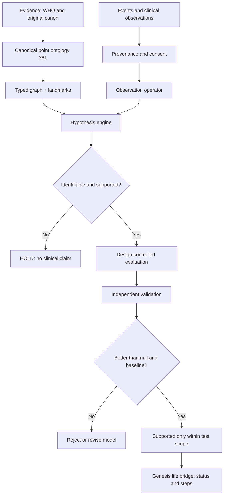

# สมการจุดแพทย์แผนจีนเชิงสารสนเทศ (TCM-Qi–Information Formal Model)

**สถานะ:** เอกสารข้อเสนอทางคณิตศาสตร์เชิงสารสนเทศสำหรับการวิจัย; **ไม่ใช่** สมการหรือแนวทางรักษาที่ได้รับการรับรองจาก WHO, ไม่ใช่การพิสูจน์การมีอยู่ของชี่ในเชิงฟิสิกส์ และไม่ใช้วินิจฉัยความผิดปกติรายบุคคล

**หลักแยกสามชั้นของหลักฐาน**

- **[CANON]** ข้อเท็จจริงเกี่ยวกับการตั้งชื่อและโครงสร้างรายการ 361 จุด / 14 เส้น ตาม WHO; คำศัพท์ตามคัมภีร์โบราณ
- **[MODEL]** สัญลักษณ์ สมการ เครือข่ายแบบจำลอง การแปลข้อมูล และการควบคุมข้อผิดพลาดที่เราสร้างขึ้นในเอกสารนี้
- **[EMPIRICAL]** ผลสังเกตและการทดลองจริงจากการแพทย์ปัจจุบัน ต้องอ้างแหล่งเฉพาะ และยังไม่รับรองความเที่ยงตรงของกราฟชี่

## 0. ขอบเขตและหลัก epistemic

1. **มาตรฐานจุด ≠ มาตรฐานฟิสิกส์ของชี่.** รหัสจุด WHO เป็นการสร้างมาตรฐานตำแหน่งบนพื้นผิวร่างกาย; ไม่ใช่ข้อพิสูจน์ว่ามีท่อส่งพลังงานตามเส้นลมปราณ
2. **อวัยวะในแพทย์จีน (臟腑 Zang-Fu) เป็น functional patterns.** `LR` ไม่ใช่การอนุมานสถานะ biochemical ของตับ, `KI` ไม่ใช่ eGFR/ฮอร์โมน, `ST` ไม่ใช่กรดกระเพาะโดยตรง
3. **บุคลิกภาพ ≠ พยาธิสภาพ:** ความต้องการทางเพศ, การแสดงออกทางกามารมณ์, การใช้ปัญญา, การโกรธ, ความหิว ต้องเป็นตัวแปรต่างกัน ไม่มีสมการบังคับว่า libido สูงหมายถึงชี่อุดตัน
4. **ไม่มีตัวเลขจำลอง:** พารามิเตอร์ทุกตัวเป็นตัวไม่ทราบค่า (`UNESTIMATED`) จนกว่าจะนำข้อมูลสังเกตจริงมาประมาณค่า ค่าตัวอย่างใน schema เป็น `null` ไม่ใช่ [SimulatedData]
5. **ความปลอดภัย:** ไม่ให้ความลึก มุมแทงเข็ม การรมยา การบังคับลมหายใจ/เบ่งท้อง หรือข้อสรุปจุดที่ต้องฝังเข็มสำหรับบุคคลใด ๆ
6. **สอดคล้องกับฐาน Genesis v5.1 โดยไม่รับรองความจริงของจักรวาลวิทยาของ Genesis.** เราใช้ความสอดคล้องทางนิยาม ไม่กล่าวอ้างว่า telegraph equation พิสูจน์การเคลื่อนของชี่

## 1. รากศัพท์คัมภีร์และความสัมพันธ์เชิงสารสนเทศ

อ้างจาก《黃帝內經·素問·舉痛論》บท 39: `怒則氣上` (โกรธ → ชี่ขึ้น), `思則氣結` (ครุ่นคิด → ชี่ผูกค้าง), `驚則氣亂` (ตกใจ → ชี่รวน), `勞則氣耗` (เหนื่อยเกิน → ชี่พร่อง) และลำดับความสัมพันธ์ของ **เก้าการเปลี่ยนชี่** (`九氣`): 怒、喜、悲、恐、寒、炅、驚、勞、思. รายการนี้เป็นการจำแนกความหมายแบบดั้งเดิม ไม่ใช่ nine-parameter dynamical law ที่วัดได้แล้ว

กำหนด lexical rule จากคัมภีร์:

\[
\mathcal{R}_{canon}=\{(\text{怒},\text{上}),(\text{喜},\text{緩}),(\text{悲},\text{消}),(\text{恐},\text{下}),(\text{寒},\text{收}),(\text{炅},\text{泄}),(\text{驚},\text{亂}),(\text{勞},\text{耗}),(\text{思},\text{結})\}.
\]

ข้อสำคัญ: สัมพันธ์นี้เป็น **ศัพท์บรรยายเชิงคุณภาพ** ไม่ใช่สมการ conservation หรือค่าการไหลเชิงปริมาตร เราต้องแปลศัพท์นี้เป็นตัวแปรแบบจำลองผ่านฟังก์ชันการเข้ารหัสที่อาจผิดได้

\[
\mathsf{Encode}:\mathcal{R}_{canon}\longrightarrow\mathcal{H}_{model},\qquad
\mathcal{H}_{model}\not\equiv\mathcal{R}_{canon}.
\]

## 2. Ontology อย่างเป็นทางการ

### 2.1 ประเภทโหนด

\[
V=V_P\ \dot\cup\ V_C\ \dot\cup\ V_Z\ \dot\cup\ V_B\ \dot\cup\ V_Y\ \dot\cup\ V_E\ \dot\cup\ V_S
\]

- `P`: จุดมาตรฐาน WHO จำนวน **361 จุด** (surface reference point)
- `C`: เส้นทางแบบอรรถศาสตร์ของแพทย์จีน **14 เส้น** (12 channels + GV, CV)
- `Z`: กลุ่มหน้าที่ **臟腑** (Zang-Fu) และ San Jiao เป็นระบบหมวดหมู่ทางตำรา
- `B`: พื้นที่กายวิภาคจริง (ผิวหนัง เส้นประสาท หลอดเลือด กล้ามเนื้อ กระดูก) — map ผ่าน WHO / UBERON / TARA ตามหลักฐาน
- `Y`: อาการ/ตัวแปรสังเกตที่วัดได้ (เช่น ระดับปวด คุณภาพนอน ความหิว น้ำตาลในเลือด อารมณ์)
- `E`: เหตุการณ์ เช่น เครียด กินอาหาร เดิน นอน พูดโต้เถียง สัมผัส
- `S`: บันทึกเหตุการณ์และต้นทางแหล่งข้อมูล (source / uncertainty / consent)

### 2.2 ประเภทเส้นเชื่อม (typed graph / hypergraph)

\[
\mathcal{G}=(V,E_{membership},E_{route},E_{surface},E_{literature},E_{observed},E_{causal})
\]

| Edge | ความหมาย | สถานะที่อนุญาต |
|---|---|---|
| `POINT_IN_CHANNEL` | จุด `p` อยู่ในกลุ่มเส้น `c` | `[CANON]` |
| `CANONICAL_NEXT` | ลำดับรหัสในเส้นมาตรฐาน (ห้ามตีความเป็นกระแสจริง) | `[CANON]` |
| `SURFACE_REGION` | จุดอ้างอิงสัมพันธ์กับบริเวณกายวิภาค | `[CANON]` เฉพาะเมื่อผ่านการตรวจตำแหน่ง WHO |
| `TCM_FUNCTIONAL_ASSOC` | คู่ Zang-Fu, Yin-Yang, five phases | `[CANON-TRADITION]` ไม่ใช่กายวิภาค |
| `REPORTED_ASSOC` | บทความ/คำอธิบายระบุว่าเกี่ยวข้องกับผลลัพธ์ | `[LITERATURE]` อาจมี confounding |
| `OBSERVED_ASSOC` | ความสัมพันธ์ทางสถิติจากข้อมูลจริง | `[EMPIRICAL]` ไม่ใช่ causal อัตโนมัติ |
| `CAUSAL_EFFECT` | ผลเชิงเหตุที่ประเมินจากการออกแบบการทดลองที่เหมาะสม | `[EMPIRICAL-CAUSAL]` เท่านั้น |

**Invariant:** `E_membership ∩ E_causal` ไม่มีการยกระดับสถานะโดยอัตโนมัติ; เส้นลมปราณที่เชื่อมต่อกันตามแผนภาพไม่ใช่หลักฐานว่าจุดหนึ่งส่งผลให้จุดอีกจุดจริง

## 3. สถานะระบบและหน่วย

กำหนดดัชนีขั้น `s=0,1,2,...` ซึ่งหมายถึง **ลำดับเหตุการณ์เชิงเหตุ (causal/observation steps)** ไม่ใช่วินาที ชั่วโมง หรือหนึ่งวันโดยกำเนิด

\[
X_s=\big(q_s,\,v_s,\,z_s,\,a_s,\,o_s,\,m_s,\,e_s\big)
\]

- `q_s ∈ R^361`: **latent point field** เพียงตัวแปรคณิตศาสตร์ ยังไม่มีเครื่องมือวัดชี่โดยตรง หน่วยเป็น arbitrary model units
- `v_s ∈ R^361`: การเปลี่ยนสถานะต่อหนึ่งขั้น (model step derivative)
- `z_s`: ข้อมูล pattern ตามศาสตร์จีน เช่น heat/cold, excess/deficiency, interior/exterior, yin/yang เป็น **ผลการอนุมาน ไม่ใช่ข้อเท็จจริงเชิงชีวเคมี**
- `a_s`: การกระทำ/สิ่งแทรกแซง เช่น พัก ฝึกหายใจ เดิน กดจุดโดยผู้เชี่ยวชาญ; ห้ามตั้ง treatment effect ล่วงหน้า
- `o_s`: observable vector จากข้อมูลจริง (หน่วยตามเครื่องมือวัด)
- `m_s`: หน่วยความจำสะสม / causal record (provenance-retaining)
- `e_s`: การกระตุ้นจากสภาพแวดล้อมและอารมณ์

ตัวแปรที่ไม่ใช่สิ่งเดียวกัน:

\[
\text{Libido}\ne\text{SexualExpression}\ne\text{SexualFunction}\ne\text{Rumination}\ne\text{Anger}\ne\text{Hunger}.
\]

ไม่ตั้ง `Libido - SexualExpression = qi blockage` เพราะสมการนั้นไม่มีการสอบเทียบเชิงประจักษ์

## 4. สมการแกน: จากจุดสู่สนามสารสนเทศ

### EQ-QI-01 — Incidence และ Laplacian บนโครงสร้างความรู้

ให้ `B∈{-1,0,+1}^{|E_route|×361}` เป็น incidence matrix ของเส้นเชื่อมเชิงตำราและ `W=diag(w_e)` มี `w_e≥0` สำหรับ edge ทางคณิตศาสตร์

\[
L=B^{\top}WB,\qquad L\succeq0,\qquad L\mathbf 1=\mathbf 0.
\]

ข้อเท็จจริงทางคณิตศาสตร์: `L` เป็น positive semidefinite ถ้า W ไม่ติดลบ ไม่มีข้อเท็จจริงทางแพทย์ตามมาจากความเป็น PSD โดยลำพัง น้ำหนัก `w_e` ไม่ควรกำหนดจากความเชื่อโดยไม่ทดสอบ

### EQ-QI-02 — Telegraph-inspired information dynamics (ข้อเสนอ ไม่ใช่กฎชีวฟิสิกส์)

\[
\tau_c \frac{d^2q}{d\sigma^2}+\frac{dq}{d\sigma}+D Lq=F(o,e,a;m)+\eta,
\]

`σ` คือ **step-coordinate ต่อเนื่องแบบอนุพันธ์ใช้เพื่อวิเคราะห์**; `τ_c>0` memory scale ในหน่วย steps, `D≥0` เป็น model coupling; `η` เป็น residual/noise; หากทดสอบไม่ได้ต้องหยุดที่ ontology และไม่ตีความ q ว่าเป็นพลังงานจริง

### EQ-QI-03 — Discrete causal stepper (สอดคล้องรูปแบบกับ Genesis MQ.08)

\[
\begin{aligned}
v_{s+1}&=v_s+h[-\gamma v_s-\gamma DLq_s+\gamma B_u u_s+\gamma\eta_s],\\
q_{s+1}&=q_s+h v_{s+1},\qquad \gamma=1/\tau_c.
\end{aligned}
\]

`B_u` คือ control-input operator (`B` ใน EQ-QI-01 เป็น incidence matrix คนละตัว); `h` คือระยะขั้นใน coordinate ของ solver ไม่ใช่เวลาธรรมชาติ; ห้ามอ้างว่า constraint เชิง numerical ใน Genesis ใช้ได้โดยตรงเมื่อเพิ่ม forcing, nonlinearity, signed edges หรือ memory switching ต้องพิสูจน์เสถียรภาพใหม่ทุกกรณี

### EQ-QI-04 — สถานะความติดขัดเชิงสารสนเทศ (`Blockage proxy`)

นิยามเพื่อการสื่อสารและการทดสอบเท่านั้น:

\[
\mathcal B_s =\frac{\big\|\Pi_\perp(q_{s+1}-q_s)\big\|_2}{\epsilon+\|Bu_s\|_2}
+\lambda_r R_s+\lambda_h H_s,
\]

- `Π⊥` ส่วนฉายตั้งฉากกับ observable subspace ที่นิยามและ lock ไว้ก่อนทดสอบ (unknown direction)
- `R_s` คะแนน rumination จากแบบประเมิน / การบันทึกที่กำหนดก่อนวิเคราะห์
- `H_s` แบบประเมินความไม่สอดคล้องเชิงพฤติกรรม (ไม่ใช่ heat ของ TCM ที่ตรวจวัดได้)
- `λ` ต้องผ่านการ fit/calibration มิฉะนั้น `B_s` เป็นเพียงสัญลักษณ์

**ข้อควรระวัง:** ตัวแปรนี้ไม่สามารถใช้บอกว่า “จุด LR3 อุดตัน” และไม่มีความหมายทางแพทย์โดยอัตโนมัติ

### EQ-QI-05 — Observation operator และตัวกรองการอนุมาน

\[
y_s=H_{phys}x^{phys}_s+H_{latent}q_s+\epsilon_s,\quad
\widehat P(z_s\mid y_{0:s},a_{0:s-1},\mathrm{provenance})
\]

**Identifiability gate:** ถ้าไม่สามารถแยก `H_latent q` ออกจาก noise / placebo / confounding ได้ ให้ระบุ `q = UNIDENTIFIABLE`; ไม่อ้างว่าอนุมานปริมาณชี่สำเร็จ แม้โมเดลจะ fit ข้อมูลอาการได้ดี

### EQ-QI-06 — Uncertainty และ provenance

\[
U_{total}=U_{measurement}+U_{selection}+U_{translation}+U_{model}+U_{confounding}.
\]

สมการนี้เป็น *upper-bound bookkeeping convention* สำหรับ nonnegative uncertainty components ไม่ใช่หลักการบวก exact variance; ถ้า error correlated ต้องใช้ covariance matrix และไม่เอาจำนวนนี้ไปทำ probability โดยตรง

### EQ-QI-07 — Energy-like quantity ใน graph ที่นิยามเอง

\[
\mathcal{E}_s=\tfrac12\tau_c v_s^{\top}v_s+\tfrac12Dq_s^{\top}Lq_s.
\]

เมื่อ **ไม่มี forcing**, `L` ตรึง, สมการเวลาเชิงต่อเนื่องเป็น linear และมี damping `γ>0` จะได้ `dE/dσ=-||v||²≤0`. หากมีการป้อนข้อมูล/แรงกระตุ้นหรือ graph เปลี่ยน ไม่รับประกันการลดลง นี่เป็น **พลังงานเชิงคณิตศาสตร์** ไม่ใช่จูลหรือชีวพลัง

### EQ-QI-08 — Modal decomposition และความคงอยู่

\[
L\phi_k=\lambda_k\phi_k,\quad q_s=\sum_k a_{k,s}\phi_k,
\quad \tau_c a''_k+a'_k+D\lambda_k a_k=f_k.
\]

นิยาม mode persistence ได้ตาม decay rate **เมื่อประมาณค่าได้** โดยไม่สรุปจากชื่อจุดแพทย์จีน การลด eigenvalue/เพิ่ม decay ไม่ใช่ตัวชี้สุขภาพทางคลินิกโดยตรง

### EQ-QI-09 — Information-grounding/status gate

\[
\operatorname{Status}(claim)=
\begin{cases}
\text{REJECT}, & \text{if contradiction / invalid provenance / causal claim without support},\\
\text{HOLD}, & \text{if insufficient data / unidentifiable / not validated},\\
\text{SUPPORTED-IN-SCOPE},&\text{if independently checked for stated scope}.
\end{cases}
\]

ชื่อ `SUPPORTED-IN-SCOPE` ใช้แทนการตัดสินเชิงอภิปรัชญาว่า TRUE; รองรับ `TRUTH/HOLD/REJECT` ของ Genesis status gate ด้วย translation layer แต่ไม่เปิดให้ข้อมูลโบราณเปลี่ยนเป็นผลการทดลองโดยพลการ

## 5. สะพานไปสมการชีวิต Genesis v5.1 (คง anchor เดิม)

จากเอกสารเดิม `genesis_v5_1.md`:

```text
Constructed time: t(s) := min #steps(s₀ → s)
Observer pipeline: M_A(E) = (T_A ∘ Π_A)(S_A(E))
Telegraph core: τ_c ∂²u/∂t² + ∂u/∂t = D ∇²u
Graph Laplacian: L = D_degree − W
Modal identity: L φ_k = λ_k φ_k
Lifecycle state: Λ_life(t) = {s(t), Φ(t), F(t), C(t), A(x(t)), Ψ'(s(t))}
Status gate: TRUTH / HOLD / REJECT
```

โดยสมการในไฟล์นี้เป็น **proposed application layer** เท่านั้น:

\[
\boxed{\mathcal{M}_{TCM}(E_s)=\underbrace{T_{TCM}}_{\substack{\text{mapping}\text{concepts}}}\circ
\underbrace{\Pi_{clinical}}_{\substack{\text{source-aware}\text{report}}}\circ
\underbrace{S_{consent}}_{\substack{\text{select}\text{observations}}}(E_s)}
\]

\[
\boxed{\Lambda_{TCM\rightarrow LIFE}(s)=
\big\{\,\Lambda_{life}(s),\ \mathcal G_{361},\ q_s,\ y_s,\ m_s,\ \mathrm{Status}_s\,\big\}}
\]

`Λ_TCM→LIFE` เป็นส่วนต่อขยายเชิงการจัดการสารสนเทศ ไม่ใช่การแก้ canonical equations ใน Genesis โดยพลการ

### ข้อห้ามในการเชื่อม

- ไม่แทน `qi` ด้วย electrical voltage, ATP, testosterone, dopamine หรือ blood flow แบบ 1:1 โดยไม่มี validation
- ไม่แทน `jing` ด้วยน้ำอสุจิ, `shen` ด้วย EEG, `yin/yang` ด้วย parasympathetic/sympathetic แบบเท่ากันโดยตรง
- ไม่สมมติว่า “จิต/บุคลิกเนิร์ดทำให้พลังทางเพศไปคั่งที่ปากหรือกระเพาะ”
- ไม่แปล `qi` เป็น measurable physical field โดยไม่มี dimensional analysis / measurement mapping
- ไม่ถือว่าการกดจุดหนึ่งจุดทำให้ทุก mode ที่อยู่บนเส้นเดียวกันเปลี่ยนแบบทันที

## 6. 14 channel classes: ระบบพิกัดเชิงหมวดหมู่

จำนวนตาม WHO 2008: **361 จุดใน 14 เส้น** (12 ช่องหลัก + 2 midline vessels) ไม่มีจุดนอกเส้น (`EX-*`) อยู่ในชุด 361 นี้

| Channel | ชื่อจีน | ทางระบบเดิม | จำนวนจุด | คำอธิบายบริเวณกว้าง |
|---|---|---|---:|---|
| `LU` | 手太陰肺經 | ปอด / Lung | 11 | นิ้วหัวแม่มือ–แขนด้านใน–ทรวงอก |
| `LI` | 手陽明大腸經 | ลำไส้ใหญ่ / Large Intestine | 20 | นิ้วชี้–หลังแขน–ใบหน้า |
| `ST` | 足陽明胃經 | กระเพาะอาหาร / Stomach | 45 | ใบหน้า–ลำตัวด้านหน้า–ขา–นิ้วเท้า |
| `SP` | 足太陰脾經 | ม้าม / Spleen | 21 | นิ้วหัวแม่เท้า–หน้าแข้งด้านใน–ท้อง–ทรวงอก |
| `HT` | 手少陰心經 | หัวใจ / Heart | 9 | รักแร้–แขนด้านใน–นิ้วก้อย |
| `SI` | 手太陽小腸經 | ลำไส้เล็ก / Small Intestine | 19 | นิ้วก้อย–หลังแขน–สะบัก–ใบหน้า |
| `BL` | 足太陽膀胱經 | กระเพาะปัสสาวะ / Bladder | 67 | หัวตา–ศีรษะ–หลัง–ด้านหลังขา–นิ้วก้อยเท้า |
| `KI` | 足少陰腎經 | ไต / Kidney | 27 | ฝ่าเท้า–ข้อเท้าด้านใน–ลำตัวด้านหน้า |
| `PC` | 手厥陰心包經 | เยื่อหุ้มหัวใจ / Pericardium | 9 | ทรวงอก–แขนด้านหน้า–นิ้วกลาง |
| `TE` | 手少陽三焦經 | ซานเจียว / Triple Energizer / San Jiao | 23 | นิ้วนาง–หลังแขน–ไหล่–ศีรษะด้านข้าง |
| `GB` | 足少陽膽經 | ถุงน้ำดี / Gallbladder | 44 | ใบหน้าด้านข้าง–ลำตัวด้านข้าง–ขาด้านนอก |
| `LR` | 足厥陰肝經 | ตับ / Liver | 14 | นิ้วหัวแม่เท้า–ขาด้านใน–ขาหนีบ–ชายโครง |
| `GV` | 督脈 | ตู๋ม่าย / Governor Vessel / Du Mai | 28 | กึ่งกลางด้านหลัง–กระดูกสันหลัง–ศีรษะ–ริมฝีปากบน |
| `CV` | 任脈 | เหรินม่าย / Conception Vessel / Ren Mai | 24 | กึ่งกลางลำตัวด้านหน้า–ท้อง–หน้าอก–ลำคอ–ริมฝีปากล่าง |

**หมายเหตุ:** รายละเอียดเส้นทางด้านบนเป็น orientation บนร่างกายเพื่อใช้จำแนกรายการ ไม่ใช่ทางกายวิภาคที่ทำหน้าที่เป็นสายส่งพลังงานที่พิสูจน์แล้ว

## 7. รายการจุดมาตรฐานทั้ง 361 จุด (WHO namespace inventory)

ตารางนี้มีครบ **361 canonical identifiers** ไม่ใช่ 361 ตำแหน่งวัดละเอียด: คอลัมน์ `region_coarse` เป็น *รหัสบริเวณกว้างเพื่อช่วยค้นข้อมูล*; ห้ามใช้ปักหมุดตำแหน่งหรือแทงเข็ม ความคลาดเคลื่อนและความแตกต่างทางกายวิภาคต้องตรวจจาก WHO 2008 ทีละจุด `WHO_location_exact_status = NOT_EMBEDDED` เพื่อหลีกเลี่ยงการประดิษฐ์ตำแหน่งหรือคัดลอกตำแหน่งฉบับเต็ม

| Point ID | Channel | region_coarse | ชื่อจีน / Pinyin (เฉพาะที่ตรวจชื่อแล้ว) |
|---|---|---|---|
| `LU-1` | `LU` | ทรวงอกส่วนบน | — (ดู WHO atlas) |
| `LU-2` | `LU` | ทรวงอกส่วนบน | — (ดู WHO atlas) |
| `LU-3` | `LU` | ต้นแขนด้านหน้า/ข้อพับศอก | — (ดู WHO atlas) |
| `LU-4` | `LU` | ต้นแขนด้านหน้า/ข้อพับศอก | — (ดู WHO atlas) |
| `LU-5` | `LU` | ต้นแขนด้านหน้า/ข้อพับศอก | — (ดู WHO atlas) |
| `LU-6` | `LU` | ต้นแขนด้านหน้า/ข้อพับศอก | — (ดู WHO atlas) |
| `LU-7` | `LU` | ท่อนแขน/ข้อมือด้านฝ่ามือ | 列缺 / Lieque |
| `LU-8` | `LU` | ท่อนแขน/ข้อมือด้านฝ่ามือ | — (ดู WHO atlas) |
| `LU-9` | `LU` | ท่อนแขน/ข้อมือด้านฝ่ามือ | 太淵 / Taiyuan |
| `LU-10` | `LU` | ฝ่ามือ/นิ้วหัวแม่มือ | — (ดู WHO atlas) |
| `LU-11` | `LU` | ฝ่ามือ/นิ้วหัวแม่มือ | — (ดู WHO atlas) |
| `LI-1` | `LI` | นิ้วชี้/หลังมือ | — (ดู WHO atlas) |
| `LI-2` | `LI` | นิ้วชี้/หลังมือ | — (ดู WHO atlas) |
| `LI-3` | `LI` | นิ้วชี้/หลังมือ | — (ดู WHO atlas) |
| `LI-4` | `LI` | นิ้วชี้/หลังมือ | 合谷 / Hegu |
| `LI-5` | `LI` | ข้อมือ/ท่อนแขน/ข้อศอก | — (ดู WHO atlas) |
| `LI-6` | `LI` | ข้อมือ/ท่อนแขน/ข้อศอก | — (ดู WHO atlas) |
| `LI-7` | `LI` | ข้อมือ/ท่อนแขน/ข้อศอก | — (ดู WHO atlas) |
| `LI-8` | `LI` | ข้อมือ/ท่อนแขน/ข้อศอก | — (ดู WHO atlas) |
| `LI-9` | `LI` | ข้อมือ/ท่อนแขน/ข้อศอก | — (ดู WHO atlas) |
| `LI-10` | `LI` | ข้อมือ/ท่อนแขน/ข้อศอก | — (ดู WHO atlas) |
| `LI-11` | `LI` | ข้อมือ/ท่อนแขน/ข้อศอก | — (ดู WHO atlas) |
| `LI-12` | `LI` | ต้นแขน/หัวไหล่ | — (ดู WHO atlas) |
| `LI-13` | `LI` | ต้นแขน/หัวไหล่ | — (ดู WHO atlas) |
| `LI-14` | `LI` | ต้นแขน/หัวไหล่ | — (ดู WHO atlas) |
| `LI-15` | `LI` | ต้นแขน/หัวไหล่ | — (ดู WHO atlas) |
| `LI-16` | `LI` | ต้นแขน/หัวไหล่ | — (ดู WHO atlas) |
| `LI-17` | `LI` | ลำคอ/ใบหน้า | — (ดู WHO atlas) |
| `LI-18` | `LI` | ลำคอ/ใบหน้า | — (ดู WHO atlas) |
| `LI-19` | `LI` | ลำคอ/ใบหน้า | — (ดู WHO atlas) |
| `LI-20` | `LI` | ลำคอ/ใบหน้า | — (ดู WHO atlas) |
| `ST-1` | `ST` | ใบหน้า/ศีรษะ | — (ดู WHO atlas) |
| `ST-2` | `ST` | ใบหน้า/ศีรษะ | — (ดู WHO atlas) |
| `ST-3` | `ST` | ใบหน้า/ศีรษะ | — (ดู WHO atlas) |
| `ST-4` | `ST` | ใบหน้า/ศีรษะ | — (ดู WHO atlas) |
| `ST-5` | `ST` | ใบหน้า/ศีรษะ | — (ดู WHO atlas) |
| `ST-6` | `ST` | ใบหน้า/ศีรษะ | — (ดู WHO atlas) |
| `ST-7` | `ST` | ใบหน้า/ศีรษะ | — (ดู WHO atlas) |
| `ST-8` | `ST` | ใบหน้า/ศีรษะ | — (ดู WHO atlas) |
| `ST-9` | `ST` | ลำคอ/ไหปลาร้า | — (ดู WHO atlas) |
| `ST-10` | `ST` | ลำคอ/ไหปลาร้า | — (ดู WHO atlas) |
| `ST-11` | `ST` | ลำคอ/ไหปลาร้า | — (ดู WHO atlas) |
| `ST-12` | `ST` | ลำคอ/ไหปลาร้า | — (ดู WHO atlas) |
| `ST-13` | `ST` | ทรวงอก | — (ดู WHO atlas) |
| `ST-14` | `ST` | ทรวงอก | — (ดู WHO atlas) |
| `ST-15` | `ST` | ทรวงอก | — (ดู WHO atlas) |
| `ST-16` | `ST` | ทรวงอก | — (ดู WHO atlas) |
| `ST-17` | `ST` | ทรวงอก | — (ดู WHO atlas) |
| `ST-18` | `ST` | ทรวงอก | — (ดู WHO atlas) |
| `ST-19` | `ST` | ท้อง | — (ดู WHO atlas) |
| `ST-20` | `ST` | ท้อง | — (ดู WHO atlas) |
| `ST-21` | `ST` | ท้อง | — (ดู WHO atlas) |
| `ST-22` | `ST` | ท้อง | — (ดู WHO atlas) |
| `ST-23` | `ST` | ท้อง | — (ดู WHO atlas) |
| `ST-24` | `ST` | ท้อง | — (ดู WHO atlas) |
| `ST-25` | `ST` | ท้อง | 天樞 / Tianshu |
| `ST-26` | `ST` | ท้อง | — (ดู WHO atlas) |
| `ST-27` | `ST` | ท้อง | — (ดู WHO atlas) |
| `ST-28` | `ST` | ท้อง | — (ดู WHO atlas) |
| `ST-29` | `ST` | ท้อง | — (ดู WHO atlas) |
| `ST-30` | `ST` | ท้อง | — (ดู WHO atlas) |
| `ST-31` | `ST` | ต้นขาด้านหน้า/เข่า | — (ดู WHO atlas) |
| `ST-32` | `ST` | ต้นขาด้านหน้า/เข่า | — (ดู WHO atlas) |
| `ST-33` | `ST` | ต้นขาด้านหน้า/เข่า | — (ดู WHO atlas) |
| `ST-34` | `ST` | ต้นขาด้านหน้า/เข่า | — (ดู WHO atlas) |
| `ST-35` | `ST` | ต้นขาด้านหน้า/เข่า | — (ดู WHO atlas) |
| `ST-36` | `ST` | ขาด้านหน้า-นอก | 足三里 / Zusanli |
| `ST-37` | `ST` | ขาด้านหน้า-นอก | — (ดู WHO atlas) |
| `ST-38` | `ST` | ขาด้านหน้า-นอก | — (ดู WHO atlas) |
| `ST-39` | `ST` | ขาด้านหน้า-นอก | — (ดู WHO atlas) |
| `ST-40` | `ST` | ขาด้านหน้า-นอก | 豐隆 / Fenglong |
| `ST-41` | `ST` | ข้อเท้า/หลังเท้า/นิ้วเท้า | — (ดู WHO atlas) |
| `ST-42` | `ST` | ข้อเท้า/หลังเท้า/นิ้วเท้า | — (ดู WHO atlas) |
| `ST-43` | `ST` | ข้อเท้า/หลังเท้า/นิ้วเท้า | — (ดู WHO atlas) |
| `ST-44` | `ST` | ข้อเท้า/หลังเท้า/นิ้วเท้า | — (ดู WHO atlas) |
| `ST-45` | `ST` | ข้อเท้า/หลังเท้า/นิ้วเท้า | — (ดู WHO atlas) |
| `SP-1` | `SP` | นิ้วหัวแม่เท้า/เท้าด้านใน | — (ดู WHO atlas) |
| `SP-2` | `SP` | นิ้วหัวแม่เท้า/เท้าด้านใน | — (ดู WHO atlas) |
| `SP-3` | `SP` | นิ้วหัวแม่เท้า/เท้าด้านใน | — (ดู WHO atlas) |
| `SP-4` | `SP` | นิ้วหัวแม่เท้า/เท้าด้านใน | — (ดู WHO atlas) |
| `SP-5` | `SP` | ข้อเท้า/หน้าแข้งด้านใน | — (ดู WHO atlas) |
| `SP-6` | `SP` | ข้อเท้า/หน้าแข้งด้านใน | 三陰交 / Sanyinjiao |
| `SP-7` | `SP` | ข้อเท้า/หน้าแข้งด้านใน | — (ดู WHO atlas) |
| `SP-8` | `SP` | ข้อเท้า/หน้าแข้งด้านใน | — (ดู WHO atlas) |
| `SP-9` | `SP` | ข้อเท้า/หน้าแข้งด้านใน | — (ดู WHO atlas) |
| `SP-10` | `SP` | ต้นขาด้านใน/ขาหนีบ | — (ดู WHO atlas) |
| `SP-11` | `SP` | ต้นขาด้านใน/ขาหนีบ | — (ดู WHO atlas) |
| `SP-12` | `SP` | ต้นขาด้านใน/ขาหนีบ | — (ดู WHO atlas) |
| `SP-13` | `SP` | ท้อง/ทรวงอกด้านข้าง | — (ดู WHO atlas) |
| `SP-14` | `SP` | ท้อง/ทรวงอกด้านข้าง | — (ดู WHO atlas) |
| `SP-15` | `SP` | ท้อง/ทรวงอกด้านข้าง | — (ดู WHO atlas) |
| `SP-16` | `SP` | ท้อง/ทรวงอกด้านข้าง | — (ดู WHO atlas) |
| `SP-17` | `SP` | ท้อง/ทรวงอกด้านข้าง | — (ดู WHO atlas) |
| `SP-18` | `SP` | ท้อง/ทรวงอกด้านข้าง | — (ดู WHO atlas) |
| `SP-19` | `SP` | ท้อง/ทรวงอกด้านข้าง | — (ดู WHO atlas) |
| `SP-20` | `SP` | ท้อง/ทรวงอกด้านข้าง | — (ดู WHO atlas) |
| `SP-21` | `SP` | ท้อง/ทรวงอกด้านข้าง | — (ดู WHO atlas) |
| `HT-1` | `HT` | รักแร้/ต้นแขนด้านใน/ข้อศอก | — (ดู WHO atlas) |
| `HT-2` | `HT` | รักแร้/ต้นแขนด้านใน/ข้อศอก | — (ดู WHO atlas) |
| `HT-3` | `HT` | รักแร้/ต้นแขนด้านใน/ข้อศอก | — (ดู WHO atlas) |
| `HT-4` | `HT` | ท่อนแขน/ข้อมือด้านใน | — (ดู WHO atlas) |
| `HT-5` | `HT` | ท่อนแขน/ข้อมือด้านใน | — (ดู WHO atlas) |
| `HT-6` | `HT` | ท่อนแขน/ข้อมือด้านใน | — (ดู WHO atlas) |
| `HT-7` | `HT` | ท่อนแขน/ข้อมือด้านใน | 神門 / Shenmen |
| `HT-8` | `HT` | ฝ่ามือ/นิ้วก้อย | — (ดู WHO atlas) |
| `HT-9` | `HT` | ฝ่ามือ/นิ้วก้อย | — (ดู WHO atlas) |
| `SI-1` | `SI` | นิ้วก้อย/ขอบมือ | — (ดู WHO atlas) |
| `SI-2` | `SI` | นิ้วก้อย/ขอบมือ | — (ดู WHO atlas) |
| `SI-3` | `SI` | นิ้วก้อย/ขอบมือ | — (ดู WHO atlas) |
| `SI-4` | `SI` | นิ้วก้อย/ขอบมือ | — (ดู WHO atlas) |
| `SI-5` | `SI` | ข้อมือ/ท่อนแขน/ข้อศอก | — (ดู WHO atlas) |
| `SI-6` | `SI` | ข้อมือ/ท่อนแขน/ข้อศอก | — (ดู WHO atlas) |
| `SI-7` | `SI` | ข้อมือ/ท่อนแขน/ข้อศอก | — (ดู WHO atlas) |
| `SI-8` | `SI` | ข้อมือ/ท่อนแขน/ข้อศอก | — (ดู WHO atlas) |
| `SI-9` | `SI` | ต้นแขน/สะบัก/หลังส่วนบน | — (ดู WHO atlas) |
| `SI-10` | `SI` | ต้นแขน/สะบัก/หลังส่วนบน | — (ดู WHO atlas) |
| `SI-11` | `SI` | ต้นแขน/สะบัก/หลังส่วนบน | — (ดู WHO atlas) |
| `SI-12` | `SI` | ต้นแขน/สะบัก/หลังส่วนบน | — (ดู WHO atlas) |
| `SI-13` | `SI` | ต้นแขน/สะบัก/หลังส่วนบน | — (ดู WHO atlas) |
| `SI-14` | `SI` | ต้นแขน/สะบัก/หลังส่วนบน | — (ดู WHO atlas) |
| `SI-15` | `SI` | ต้นแขน/สะบัก/หลังส่วนบน | — (ดู WHO atlas) |
| `SI-16` | `SI` | คอ/ใบหน้า/ใกล้หู | — (ดู WHO atlas) |
| `SI-17` | `SI` | คอ/ใบหน้า/ใกล้หู | — (ดู WHO atlas) |
| `SI-18` | `SI` | คอ/ใบหน้า/ใกล้หู | — (ดู WHO atlas) |
| `SI-19` | `SI` | คอ/ใบหน้า/ใกล้หู | — (ดู WHO atlas) |
| `BL-1` | `BL` | หัวตา/ศีรษะ/คอ | — (ดู WHO atlas) |
| `BL-2` | `BL` | หัวตา/ศีรษะ/คอ | — (ดู WHO atlas) |
| `BL-3` | `BL` | หัวตา/ศีรษะ/คอ | — (ดู WHO atlas) |
| `BL-4` | `BL` | หัวตา/ศีรษะ/คอ | — (ดู WHO atlas) |
| `BL-5` | `BL` | หัวตา/ศีรษะ/คอ | — (ดู WHO atlas) |
| `BL-6` | `BL` | หัวตา/ศีรษะ/คอ | — (ดู WHO atlas) |
| `BL-7` | `BL` | หัวตา/ศีรษะ/คอ | — (ดู WHO atlas) |
| `BL-8` | `BL` | หัวตา/ศีรษะ/คอ | — (ดู WHO atlas) |
| `BL-9` | `BL` | หัวตา/ศีรษะ/คอ | — (ดู WHO atlas) |
| `BL-10` | `BL` | หัวตา/ศีรษะ/คอ | — (ดู WHO atlas) |
| `BL-11` | `BL` | หลังส่วนบนถึงเอว แนวด้านใน | — (ดู WHO atlas) |
| `BL-12` | `BL` | หลังส่วนบนถึงเอว แนวด้านใน | — (ดู WHO atlas) |
| `BL-13` | `BL` | หลังส่วนบนถึงเอว แนวด้านใน | — (ดู WHO atlas) |
| `BL-14` | `BL` | หลังส่วนบนถึงเอว แนวด้านใน | — (ดู WHO atlas) |
| `BL-15` | `BL` | หลังส่วนบนถึงเอว แนวด้านใน | — (ดู WHO atlas) |
| `BL-16` | `BL` | หลังส่วนบนถึงเอว แนวด้านใน | — (ดู WHO atlas) |
| `BL-17` | `BL` | หลังส่วนบนถึงเอว แนวด้านใน | — (ดู WHO atlas) |
| `BL-18` | `BL` | หลังส่วนบนถึงเอว แนวด้านใน | — (ดู WHO atlas) |
| `BL-19` | `BL` | หลังส่วนบนถึงเอว แนวด้านใน | — (ดู WHO atlas) |
| `BL-20` | `BL` | หลังส่วนบนถึงเอว แนวด้านใน | — (ดู WHO atlas) |
| `BL-21` | `BL` | หลังส่วนบนถึงเอว แนวด้านใน | — (ดู WHO atlas) |
| `BL-22` | `BL` | หลังส่วนบนถึงเอว แนวด้านใน | — (ดู WHO atlas) |
| `BL-23` | `BL` | หลังส่วนบนถึงเอว แนวด้านใน | 腎俞 / Shenshu |
| `BL-24` | `BL` | หลังส่วนบนถึงเอว แนวด้านใน | — (ดู WHO atlas) |
| `BL-25` | `BL` | หลังส่วนบนถึงเอว แนวด้านใน | — (ดู WHO atlas) |
| `BL-26` | `BL` | หลังส่วนบนถึงเอว แนวด้านใน | — (ดู WHO atlas) |
| `BL-27` | `BL` | หลังส่วนบนถึงเอว แนวด้านใน | — (ดู WHO atlas) |
| `BL-28` | `BL` | หลังส่วนบนถึงเอว แนวด้านใน | — (ดู WHO atlas) |
| `BL-29` | `BL` | หลังส่วนบนถึงเอว แนวด้านใน | — (ดู WHO atlas) |
| `BL-30` | `BL` | หลังส่วนบนถึงเอว แนวด้านใน | — (ดู WHO atlas) |
| `BL-31` | `BL` | กระเบนเหน็บ/รอบก้นกบ | — (ดู WHO atlas) |
| `BL-32` | `BL` | กระเบนเหน็บ/รอบก้นกบ | — (ดู WHO atlas) |
| `BL-33` | `BL` | กระเบนเหน็บ/รอบก้นกบ | — (ดู WHO atlas) |
| `BL-34` | `BL` | กระเบนเหน็บ/รอบก้นกบ | — (ดู WHO atlas) |
| `BL-35` | `BL` | กระเบนเหน็บ/รอบก้นกบ | — (ดู WHO atlas) |
| `BL-36` | `BL` | สะโพก/ต้นขาด้านหลัง/เข่า | — (ดู WHO atlas) |
| `BL-37` | `BL` | สะโพก/ต้นขาด้านหลัง/เข่า | — (ดู WHO atlas) |
| `BL-38` | `BL` | สะโพก/ต้นขาด้านหลัง/เข่า | — (ดู WHO atlas) |
| `BL-39` | `BL` | สะโพก/ต้นขาด้านหลัง/เข่า | — (ดู WHO atlas) |
| `BL-40` | `BL` | สะโพก/ต้นขาด้านหลัง/เข่า | — (ดู WHO atlas) |
| `BL-41` | `BL` | หลังแนวด้านนอก/สะโพก | — (ดู WHO atlas) |
| `BL-42` | `BL` | หลังแนวด้านนอก/สะโพก | — (ดู WHO atlas) |
| `BL-43` | `BL` | หลังแนวด้านนอก/สะโพก | — (ดู WHO atlas) |
| `BL-44` | `BL` | หลังแนวด้านนอก/สะโพก | — (ดู WHO atlas) |
| `BL-45` | `BL` | หลังแนวด้านนอก/สะโพก | — (ดู WHO atlas) |
| `BL-46` | `BL` | หลังแนวด้านนอก/สะโพก | — (ดู WHO atlas) |
| `BL-47` | `BL` | หลังแนวด้านนอก/สะโพก | — (ดู WHO atlas) |
| `BL-48` | `BL` | หลังแนวด้านนอก/สะโพก | — (ดู WHO atlas) |
| `BL-49` | `BL` | หลังแนวด้านนอก/สะโพก | — (ดู WHO atlas) |
| `BL-50` | `BL` | หลังแนวด้านนอก/สะโพก | — (ดู WHO atlas) |
| `BL-51` | `BL` | หลังแนวด้านนอก/สะโพก | — (ดู WHO atlas) |
| `BL-52` | `BL` | หลังแนวด้านนอก/สะโพก | — (ดู WHO atlas) |
| `BL-53` | `BL` | หลังแนวด้านนอก/สะโพก | — (ดู WHO atlas) |
| `BL-54` | `BL` | หลังแนวด้านนอก/สะโพก | — (ดู WHO atlas) |
| `BL-55` | `BL` | น่อง/ข้อเท้าด้านหลัง-นอก | — (ดู WHO atlas) |
| `BL-56` | `BL` | น่อง/ข้อเท้าด้านหลัง-นอก | — (ดู WHO atlas) |
| `BL-57` | `BL` | น่อง/ข้อเท้าด้านหลัง-นอก | — (ดู WHO atlas) |
| `BL-58` | `BL` | น่อง/ข้อเท้าด้านหลัง-นอก | — (ดู WHO atlas) |
| `BL-59` | `BL` | น่อง/ข้อเท้าด้านหลัง-นอก | — (ดู WHO atlas) |
| `BL-60` | `BL` | น่อง/ข้อเท้าด้านหลัง-นอก | — (ดู WHO atlas) |
| `BL-61` | `BL` | ขอบเท้าด้านนอก/นิ้วก้อยเท้า | — (ดู WHO atlas) |
| `BL-62` | `BL` | ขอบเท้าด้านนอก/นิ้วก้อยเท้า | — (ดู WHO atlas) |
| `BL-63` | `BL` | ขอบเท้าด้านนอก/นิ้วก้อยเท้า | — (ดู WHO atlas) |
| `BL-64` | `BL` | ขอบเท้าด้านนอก/นิ้วก้อยเท้า | — (ดู WHO atlas) |
| `BL-65` | `BL` | ขอบเท้าด้านนอก/นิ้วก้อยเท้า | — (ดู WHO atlas) |
| `BL-66` | `BL` | ขอบเท้าด้านนอก/นิ้วก้อยเท้า | — (ดู WHO atlas) |
| `BL-67` | `BL` | ขอบเท้าด้านนอก/นิ้วก้อยเท้า | — (ดู WHO atlas) |
| `KI-1` | `KI` | ฝ่าเท้า/ข้อเท้าด้านใน | 湧泉 / Yongquan |
| `KI-2` | `KI` | ฝ่าเท้า/ข้อเท้าด้านใน | — (ดู WHO atlas) |
| `KI-3` | `KI` | ฝ่าเท้า/ข้อเท้าด้านใน | 太溪 / Taixi |
| `KI-4` | `KI` | ฝ่าเท้า/ข้อเท้าด้านใน | — (ดู WHO atlas) |
| `KI-5` | `KI` | ฝ่าเท้า/ข้อเท้าด้านใน | — (ดู WHO atlas) |
| `KI-6` | `KI` | ฝ่าเท้า/ข้อเท้าด้านใน | — (ดู WHO atlas) |
| `KI-7` | `KI` | น่องด้านใน/เข่า | — (ดู WHO atlas) |
| `KI-8` | `KI` | น่องด้านใน/เข่า | — (ดู WHO atlas) |
| `KI-9` | `KI` | น่องด้านใน/เข่า | — (ดู WHO atlas) |
| `KI-10` | `KI` | น่องด้านใน/เข่า | — (ดู WHO atlas) |
| `KI-11` | `KI` | ท้องส่วนล่างถึงบน | — (ดู WHO atlas) |
| `KI-12` | `KI` | ท้องส่วนล่างถึงบน | — (ดู WHO atlas) |
| `KI-13` | `KI` | ท้องส่วนล่างถึงบน | — (ดู WHO atlas) |
| `KI-14` | `KI` | ท้องส่วนล่างถึงบน | — (ดู WHO atlas) |
| `KI-15` | `KI` | ท้องส่วนล่างถึงบน | — (ดู WHO atlas) |
| `KI-16` | `KI` | ท้องส่วนล่างถึงบน | — (ดู WHO atlas) |
| `KI-17` | `KI` | ท้องส่วนล่างถึงบน | — (ดู WHO atlas) |
| `KI-18` | `KI` | ท้องส่วนล่างถึงบน | — (ดู WHO atlas) |
| `KI-19` | `KI` | ท้องส่วนล่างถึงบน | — (ดู WHO atlas) |
| `KI-20` | `KI` | ท้องส่วนล่างถึงบน | — (ดู WHO atlas) |
| `KI-21` | `KI` | ท้องส่วนล่างถึงบน | — (ดู WHO atlas) |
| `KI-22` | `KI` | ทรวงอก | — (ดู WHO atlas) |
| `KI-23` | `KI` | ทรวงอก | — (ดู WHO atlas) |
| `KI-24` | `KI` | ทรวงอก | — (ดู WHO atlas) |
| `KI-25` | `KI` | ทรวงอก | — (ดู WHO atlas) |
| `KI-26` | `KI` | ทรวงอก | — (ดู WHO atlas) |
| `KI-27` | `KI` | ทรวงอก | — (ดู WHO atlas) |
| `PC-1` | `PC` | ทรวงอก | — (ดู WHO atlas) |
| `PC-2` | `PC` | ต้นแขนด้านหน้า/ข้อศอก | — (ดู WHO atlas) |
| `PC-3` | `PC` | ต้นแขนด้านหน้า/ข้อศอก | — (ดู WHO atlas) |
| `PC-4` | `PC` | ท่อนแขน/ข้อมือด้านใน | — (ดู WHO atlas) |
| `PC-5` | `PC` | ท่อนแขน/ข้อมือด้านใน | — (ดู WHO atlas) |
| `PC-6` | `PC` | ท่อนแขน/ข้อมือด้านใน | 內關 / Neiguan |
| `PC-7` | `PC` | ท่อนแขน/ข้อมือด้านใน | — (ดู WHO atlas) |
| `PC-8` | `PC` | ฝ่ามือ/นิ้วกลาง | — (ดู WHO atlas) |
| `PC-9` | `PC` | ฝ่ามือ/นิ้วกลาง | — (ดู WHO atlas) |
| `TE-1` | `TE` | นิ้วนาง/หลังมือ | — (ดู WHO atlas) |
| `TE-2` | `TE` | นิ้วนาง/หลังมือ | — (ดู WHO atlas) |
| `TE-3` | `TE` | นิ้วนาง/หลังมือ | — (ดู WHO atlas) |
| `TE-4` | `TE` | ข้อมือ/ท่อนแขนด้านหลัง | — (ดู WHO atlas) |
| `TE-5` | `TE` | ข้อมือ/ท่อนแขนด้านหลัง | — (ดู WHO atlas) |
| `TE-6` | `TE` | ข้อมือ/ท่อนแขนด้านหลัง | — (ดู WHO atlas) |
| `TE-7` | `TE` | ข้อมือ/ท่อนแขนด้านหลัง | — (ดู WHO atlas) |
| `TE-8` | `TE` | ข้อมือ/ท่อนแขนด้านหลัง | — (ดู WHO atlas) |
| `TE-9` | `TE` | ข้อมือ/ท่อนแขนด้านหลัง | — (ดู WHO atlas) |
| `TE-10` | `TE` | ข้อศอก/ต้นแขน/หัวไหล่ | — (ดู WHO atlas) |
| `TE-11` | `TE` | ข้อศอก/ต้นแขน/หัวไหล่ | — (ดู WHO atlas) |
| `TE-12` | `TE` | ข้อศอก/ต้นแขน/หัวไหล่ | — (ดู WHO atlas) |
| `TE-13` | `TE` | ข้อศอก/ต้นแขน/หัวไหล่ | — (ดู WHO atlas) |
| `TE-14` | `TE` | ข้อศอก/ต้นแขน/หัวไหล่ | — (ดู WHO atlas) |
| `TE-15` | `TE` | บ่า/ลำคอ/หลังหู | — (ดู WHO atlas) |
| `TE-16` | `TE` | บ่า/ลำคอ/หลังหู | — (ดู WHO atlas) |
| `TE-17` | `TE` | บ่า/ลำคอ/หลังหู | — (ดู WHO atlas) |
| `TE-18` | `TE` | รอบหู/ขมับ/หางคิ้ว | — (ดู WHO atlas) |
| `TE-19` | `TE` | รอบหู/ขมับ/หางคิ้ว | — (ดู WHO atlas) |
| `TE-20` | `TE` | รอบหู/ขมับ/หางคิ้ว | — (ดู WHO atlas) |
| `TE-21` | `TE` | รอบหู/ขมับ/หางคิ้ว | — (ดู WHO atlas) |
| `TE-22` | `TE` | รอบหู/ขมับ/หางคิ้ว | — (ดู WHO atlas) |
| `TE-23` | `TE` | รอบหู/ขมับ/หางคิ้ว | — (ดู WHO atlas) |
| `GB-1` | `GB` | ขมับ/ศีรษะด้านข้าง/คอ | — (ดู WHO atlas) |
| `GB-2` | `GB` | ขมับ/ศีรษะด้านข้าง/คอ | — (ดู WHO atlas) |
| `GB-3` | `GB` | ขมับ/ศีรษะด้านข้าง/คอ | — (ดู WHO atlas) |
| `GB-4` | `GB` | ขมับ/ศีรษะด้านข้าง/คอ | — (ดู WHO atlas) |
| `GB-5` | `GB` | ขมับ/ศีรษะด้านข้าง/คอ | — (ดู WHO atlas) |
| `GB-6` | `GB` | ขมับ/ศีรษะด้านข้าง/คอ | — (ดู WHO atlas) |
| `GB-7` | `GB` | ขมับ/ศีรษะด้านข้าง/คอ | — (ดู WHO atlas) |
| `GB-8` | `GB` | ขมับ/ศีรษะด้านข้าง/คอ | — (ดู WHO atlas) |
| `GB-9` | `GB` | ขมับ/ศีรษะด้านข้าง/คอ | — (ดู WHO atlas) |
| `GB-10` | `GB` | ขมับ/ศีรษะด้านข้าง/คอ | — (ดู WHO atlas) |
| `GB-11` | `GB` | ขมับ/ศีรษะด้านข้าง/คอ | — (ดู WHO atlas) |
| `GB-12` | `GB` | ขมับ/ศีรษะด้านข้าง/คอ | — (ดู WHO atlas) |
| `GB-13` | `GB` | ขมับ/ศีรษะด้านข้าง/คอ | — (ดู WHO atlas) |
| `GB-14` | `GB` | ขมับ/ศีรษะด้านข้าง/คอ | — (ดู WHO atlas) |
| `GB-15` | `GB` | ขมับ/ศีรษะด้านข้าง/คอ | — (ดู WHO atlas) |
| `GB-16` | `GB` | ขมับ/ศีรษะด้านข้าง/คอ | — (ดู WHO atlas) |
| `GB-17` | `GB` | ขมับ/ศีรษะด้านข้าง/คอ | — (ดู WHO atlas) |
| `GB-18` | `GB` | ขมับ/ศีรษะด้านข้าง/คอ | — (ดู WHO atlas) |
| `GB-19` | `GB` | ขมับ/ศีรษะด้านข้าง/คอ | — (ดู WHO atlas) |
| `GB-20` | `GB` | ขมับ/ศีรษะด้านข้าง/คอ | 風池 / Fengchi |
| `GB-21` | `GB` | หัวไหล่/ชายโครงด้านข้าง/สะโพก | — (ดู WHO atlas) |
| `GB-22` | `GB` | หัวไหล่/ชายโครงด้านข้าง/สะโพก | — (ดู WHO atlas) |
| `GB-23` | `GB` | หัวไหล่/ชายโครงด้านข้าง/สะโพก | — (ดู WHO atlas) |
| `GB-24` | `GB` | หัวไหล่/ชายโครงด้านข้าง/สะโพก | — (ดู WHO atlas) |
| `GB-25` | `GB` | หัวไหล่/ชายโครงด้านข้าง/สะโพก | — (ดู WHO atlas) |
| `GB-26` | `GB` | หัวไหล่/ชายโครงด้านข้าง/สะโพก | — (ดู WHO atlas) |
| `GB-27` | `GB` | หัวไหล่/ชายโครงด้านข้าง/สะโพก | — (ดู WHO atlas) |
| `GB-28` | `GB` | หัวไหล่/ชายโครงด้านข้าง/สะโพก | — (ดู WHO atlas) |
| `GB-29` | `GB` | หัวไหล่/ชายโครงด้านข้าง/สะโพก | — (ดู WHO atlas) |
| `GB-30` | `GB` | หัวไหล่/ชายโครงด้านข้าง/สะโพก | — (ดู WHO atlas) |
| `GB-31` | `GB` | ต้นขาด้านนอก/เข่า | — (ดู WHO atlas) |
| `GB-32` | `GB` | ต้นขาด้านนอก/เข่า | — (ดู WHO atlas) |
| `GB-33` | `GB` | ต้นขาด้านนอก/เข่า | — (ดู WHO atlas) |
| `GB-34` | `GB` | ต้นขาด้านนอก/เข่า | 陽陵泉 / Yanglingquan |
| `GB-35` | `GB` | น่องด้านนอก/ข้อเท้า | — (ดู WHO atlas) |
| `GB-36` | `GB` | น่องด้านนอก/ข้อเท้า | — (ดู WHO atlas) |
| `GB-37` | `GB` | น่องด้านนอก/ข้อเท้า | — (ดู WHO atlas) |
| `GB-38` | `GB` | น่องด้านนอก/ข้อเท้า | — (ดู WHO atlas) |
| `GB-39` | `GB` | น่องด้านนอก/ข้อเท้า | — (ดู WHO atlas) |
| `GB-40` | `GB` | น่องด้านนอก/ข้อเท้า | — (ดู WHO atlas) |
| `GB-41` | `GB` | หลังเท้า/นิ้วเท้าที่สี่ | — (ดู WHO atlas) |
| `GB-42` | `GB` | หลังเท้า/นิ้วเท้าที่สี่ | — (ดู WHO atlas) |
| `GB-43` | `GB` | หลังเท้า/นิ้วเท้าที่สี่ | — (ดู WHO atlas) |
| `GB-44` | `GB` | หลังเท้า/นิ้วเท้าที่สี่ | — (ดู WHO atlas) |
| `LR-1` | `LR` | นิ้วหัวแม่เท้า/หลังเท้า/ข้อเท้า | — (ดู WHO atlas) |
| `LR-2` | `LR` | นิ้วหัวแม่เท้า/หลังเท้า/ข้อเท้า | — (ดู WHO atlas) |
| `LR-3` | `LR` | นิ้วหัวแม่เท้า/หลังเท้า/ข้อเท้า | 太衝 / Taichong |
| `LR-4` | `LR` | นิ้วหัวแม่เท้า/หลังเท้า/ข้อเท้า | — (ดู WHO atlas) |
| `LR-5` | `LR` | ขาด้านใน/เข่า | — (ดู WHO atlas) |
| `LR-6` | `LR` | ขาด้านใน/เข่า | — (ดู WHO atlas) |
| `LR-7` | `LR` | ขาด้านใน/เข่า | — (ดู WHO atlas) |
| `LR-8` | `LR` | ขาด้านใน/เข่า | — (ดู WHO atlas) |
| `LR-9` | `LR` | ต้นขาด้านใน/ขาหนีบ | — (ดู WHO atlas) |
| `LR-10` | `LR` | ต้นขาด้านใน/ขาหนีบ | — (ดู WHO atlas) |
| `LR-11` | `LR` | ต้นขาด้านใน/ขาหนีบ | — (ดู WHO atlas) |
| `LR-12` | `LR` | ต้นขาด้านใน/ขาหนีบ | — (ดู WHO atlas) |
| `LR-13` | `LR` | ชายโครง/ทรวงอกด้านหน้า-ข้าง | — (ดู WHO atlas) |
| `LR-14` | `LR` | ชายโครง/ทรวงอกด้านหน้า-ข้าง | — (ดู WHO atlas) |
| `GV-1` | `GV` | ฝีเย็บ/เอวส่วนล่าง | — (ดู WHO atlas) |
| `GV-2` | `GV` | ฝีเย็บ/เอวส่วนล่าง | — (ดู WHO atlas) |
| `GV-3` | `GV` | ฝีเย็บ/เอวส่วนล่าง | — (ดู WHO atlas) |
| `GV-4` | `GV` | ฝีเย็บ/เอวส่วนล่าง | — (ดู WHO atlas) |
| `GV-5` | `GV` | แนวกระดูกสันหลัง/หลังส่วนบน | — (ดู WHO atlas) |
| `GV-6` | `GV` | แนวกระดูกสันหลัง/หลังส่วนบน | — (ดู WHO atlas) |
| `GV-7` | `GV` | แนวกระดูกสันหลัง/หลังส่วนบน | — (ดู WHO atlas) |
| `GV-8` | `GV` | แนวกระดูกสันหลัง/หลังส่วนบน | — (ดู WHO atlas) |
| `GV-9` | `GV` | แนวกระดูกสันหลัง/หลังส่วนบน | — (ดู WHO atlas) |
| `GV-10` | `GV` | แนวกระดูกสันหลัง/หลังส่วนบน | — (ดู WHO atlas) |
| `GV-11` | `GV` | แนวกระดูกสันหลัง/หลังส่วนบน | — (ดู WHO atlas) |
| `GV-12` | `GV` | แนวกระดูกสันหลัง/หลังส่วนบน | — (ดู WHO atlas) |
| `GV-13` | `GV` | แนวกระดูกสันหลัง/หลังส่วนบน | — (ดู WHO atlas) |
| `GV-14` | `GV` | แนวกระดูกสันหลัง/หลังส่วนบน | — (ดู WHO atlas) |
| `GV-15` | `GV` | ต้นคอ/ท้ายทอย | — (ดู WHO atlas) |
| `GV-16` | `GV` | ต้นคอ/ท้ายทอย | — (ดู WHO atlas) |
| `GV-17` | `GV` | ศีรษะ/หน้าผากแนวกึ่งกลาง | — (ดู WHO atlas) |
| `GV-18` | `GV` | ศีรษะ/หน้าผากแนวกึ่งกลาง | — (ดู WHO atlas) |
| `GV-19` | `GV` | ศีรษะ/หน้าผากแนวกึ่งกลาง | — (ดู WHO atlas) |
| `GV-20` | `GV` | ศีรษะ/หน้าผากแนวกึ่งกลาง | 百會 / Baihui |
| `GV-21` | `GV` | ศีรษะ/หน้าผากแนวกึ่งกลาง | — (ดู WHO atlas) |
| `GV-22` | `GV` | ศีรษะ/หน้าผากแนวกึ่งกลาง | — (ดู WHO atlas) |
| `GV-23` | `GV` | ศีรษะ/หน้าผากแนวกึ่งกลาง | — (ดู WHO atlas) |
| `GV-24` | `GV` | ศีรษะ/หน้าผากแนวกึ่งกลาง | — (ดู WHO atlas) |
| `GV-25` | `GV` | จมูก/ริมฝีปาก/เหงือกบน | — (ดู WHO atlas) |
| `GV-26` | `GV` | จมูก/ริมฝีปาก/เหงือกบน | — (ดู WHO atlas) |
| `GV-27` | `GV` | จมูก/ริมฝีปาก/เหงือกบน | — (ดู WHO atlas) |
| `GV-28` | `GV` | จมูก/ริมฝีปาก/เหงือกบน | — (ดู WHO atlas) |
| `CV-1` | `CV` | ฝีเย็บ/เหนือหัวหน่าว | — (ดู WHO atlas) |
| `CV-2` | `CV` | ฝีเย็บ/เหนือหัวหน่าว | — (ดู WHO atlas) |
| `CV-3` | `CV` | ท้องส่วนล่าง/สะดือ | — (ดู WHO atlas) |
| `CV-4` | `CV` | ท้องส่วนล่าง/สะดือ | 關元 / Guanyuan |
| `CV-5` | `CV` | ท้องส่วนล่าง/สะดือ | — (ดู WHO atlas) |
| `CV-6` | `CV` | ท้องส่วนล่าง/สะดือ | 氣海 / Qihai |
| `CV-7` | `CV` | ท้องส่วนล่าง/สะดือ | — (ดู WHO atlas) |
| `CV-8` | `CV` | ท้องส่วนล่าง/สะดือ | — (ดู WHO atlas) |
| `CV-9` | `CV` | ท้องส่วนบน/ลิ้นปี่ | — (ดู WHO atlas) |
| `CV-10` | `CV` | ท้องส่วนบน/ลิ้นปี่ | — (ดู WHO atlas) |
| `CV-11` | `CV` | ท้องส่วนบน/ลิ้นปี่ | — (ดู WHO atlas) |
| `CV-12` | `CV` | ท้องส่วนบน/ลิ้นปี่ | 中脘 / Zhongwan |
| `CV-13` | `CV` | ท้องส่วนบน/ลิ้นปี่ | — (ดู WHO atlas) |
| `CV-14` | `CV` | ท้องส่วนบน/ลิ้นปี่ | — (ดู WHO atlas) |
| `CV-15` | `CV` | ท้องส่วนบน/ลิ้นปี่ | — (ดู WHO atlas) |
| `CV-16` | `CV` | ทรวงอกแนวกึ่งกลาง/ลำคอ | — (ดู WHO atlas) |
| `CV-17` | `CV` | ทรวงอกแนวกึ่งกลาง/ลำคอ | — (ดู WHO atlas) |
| `CV-18` | `CV` | ทรวงอกแนวกึ่งกลาง/ลำคอ | — (ดู WHO atlas) |
| `CV-19` | `CV` | ทรวงอกแนวกึ่งกลาง/ลำคอ | — (ดู WHO atlas) |
| `CV-20` | `CV` | ทรวงอกแนวกึ่งกลาง/ลำคอ | — (ดู WHO atlas) |
| `CV-21` | `CV` | ทรวงอกแนวกึ่งกลาง/ลำคอ | — (ดู WHO atlas) |
| `CV-22` | `CV` | ทรวงอกแนวกึ่งกลาง/ลำคอ | — (ดู WHO atlas) |
| `CV-23` | `CV` | ใต้คาง/ริมฝีปากล่าง | — (ดู WHO atlas) |
| `CV-24` | `CV` | ใต้คาง/ริมฝีปากล่าง | — (ดู WHO atlas) |

**VALIDATION:** รหัสเป็นสัญลักษณ์ canonical; `LU=11, LI=20, ST=45, SP=21, HT=9, SI=19, BL=67, KI=27, PC=9, TE=23, GB=44, LR=14, GV=28, CV=24`, รวม **361**, รหัสไม่ซ้ำกันตามแบบสร้างเอกสาร

## 8. Surface atlas เชิงอธิบาย: ชุดจุดที่มีชื่อและบริเวณรองรับ

ตารางต่อไปนี้เป็น **landmark เชิงคำอธิบาย** เพื่อจัดหมวดหมู่และวางระบบข้อมูล ไม่ใช้ตัดสินตำแหน่งฝังเข็ม การกำหนด exact point ใช้ WHO 2008 + ผู้เชี่ยวชาญทุกครั้ง คำว่า `cun` หรือ `B-cun` เป็นมาตรวัดสัดส่วนร่างกาย ไม่ใช่จำนวนเซนติเมตรสากลคงที่

| Code | 中文 | Pinyin | บริเวณ/landmark โดยสังเขป | provenance / caveat |
|---|---|---|---|---|
| `LU-7` | 列缺 | Lieque | ด้านเหนือข้อมือฝั่งนิ้วหัวแม่มือ | ชื่อมาตรฐาน; ตำแหน่งต้องตรวจ WHO ก่อนใช้งาน |
| `LU-9` | 太淵 | Taiyuan | ข้อมือด้านฝ่ามือใกล้โคนหัวแม่มือ | ตำแหน่งใกล้หลอดเลือด ห้ามใช้เอกสารนี้กำหนดแนวเข็ม |
| `LI-4` | 合谷 | Hegu | หลังมือระหว่างโคนนิ้วหัวแม่มือกับนิ้วชี้ | ตำแหน่งกดด้วยตนเองตาม MSKCC; หลีกเลี่ยงในผู้ตั้งครรภ์ |
| `ST-25` | 天樞 | Tianshu | หน้าท้องระดับสะดือ ห่างแนวกึ่งกลางประมาณ 2 B-cun | ตำแหน่งอ้างอิงงานวิจัย |
| `ST-36` | 足三里 | Zusanli | หน้าแข้งด้านนอก ใต้หัวเข่า | จุดมาตรฐาน; การวัด B-cun ตาม WHO |
| `ST-40` | 豐隆 | Fenglong | ขาส่วนล่างด้านนอก | ตำแหน่งอ้างอิงงานวิจัย |
| `SP-6` | 三陰交 | Sanyinjiao | เหนือปุ่มกระดูกข้อเท้าด้านในบริเวณหลังขอบกระดูกหน้าแข้ง | จุดมาตรฐาน; ไม่ใช้เอกสารนี้เพื่อฝังเข็ม |
| `HT-7` | 神門 | Shenmen | ข้อมือด้านฝ่ามือ ฝั่งนิ้วก้อย | ตำแหน่งอ้างอิงงานวิจัย |
| `BL-23` | 腎俞 | Shenshu | หลังบริเวณเอวระดับกระดูกสันหลังเอวข้อ 2 ด้านข้างแนวกึ่งกลาง | ไม่ใช่ตำแหน่งของไตทางกายวิภาคโดยตรง |
| `KI-1` | 湧泉 | Yongquan | ฝ่าเท้า | ไม่ใช่การวัดสนามพลัง |
| `KI-3` | 太溪 | Taixi | ระหว่างตาตุ่มด้านในกับเอ็นร้อยหวาย | ตำแหน่งอ้างอิงงานวิจัย |
| `PC-6` | 內關 | Neiguan | ท่อนแขนด้านใน เหนือรอยพับข้อมือระหว่างเส้นเอ็นใหญ่สองเส้น | MSKCC มีคำแนะนำการกดจุดสำหรับคลื่นไส้ |
| `GB-20` | 風池 | Fengchi | ท้ายทอยด้านข้าง | ไม่กดแรงบริเวณลำคอ |
| `GB-34` | 陽陵泉 | Yanglingquan | น่องส่วนบนด้านนอกใกล้หัวกระดูก fibula | ตำแหน่งทั่วไปเท่านั้น |
| `LR-3` | 太衝 | Taichong | หลังเท้าระหว่างกระดูกฝ่าเท้าที่ 1–2 ใกล้ส่วนฐาน | บริเวณมีหลอดเลือด ไม่ฝังเข็มเอง |
| `GV-20` | 百會 | Baihui | กลางศีรษะตามแนวกลาง | ตำแหน่งอ้างอิงงานวิจัย |
| `CV-4` | 關元 | Guanyuan | กึ่งกลางท้องส่วนล่าง ใต้สะดือประมาณ 3 B-cun | การอ้างขนาดเป็นสัดส่วนร่างกาย ไม่ใช่เซนติเมตรคงที่ |
| `CV-6` | 氣海 | Qihai | กึ่งกลางท้องส่วนล่าง ใต้สะดือประมาณ 1.5 B-cun | ไม่ใช่ถังบรรจุพลังทางสรีรวิทยา |
| `CV-12` | 中脘 | Zhongwan | กึ่งกลางท้องส่วนบน เหนือสะดือประมาณ 4 B-cun | จุดอ้างอิงกายวิภาคตามงานวิจัย |

### จุดนอก 361 ในการพัฒนาระบบ

- `EX-HN3` หรือ `Yintang (印堂)` คือจุดนอก 14 เส้นที่ใช้ในบางชุดชื่อมาตรฐาน อยู่ระหว่างคิ้วทั้งสอง **ไม่เพิ่มเข้า count 361**; บางงานใช้รหัส `GV29` แทน จึงต้องเก็บ `vocabulary_source` แยกเพื่อป้องกันการนับจุดเดียวซ้ำ
- `EX-*` แยก namespace อิสระและ mapping จาก ontology ที่เชื่อถือได้ ห้ามนำมาปะปนกับรหัส WHO classical 361
- ถ้าตำแหน่งจุดมีข้อขัดแย้งระหว่างโรงเรียนหรือฉบับ ให้มี `location_conflict=true` และ `HOLD` ไม่เติมค่าจุดเดา

## 9. Mapping ของระบบจำแนกแพทย์จีน

### 9.1 Five phases (五行) เชิง symbolic typing

`木 Wood ↔ Liver/Gallbladder`, `火 Fire ↔ Heart/Small Intestine + Pericardium/San Jiao`, `土 Earth ↔ Spleen/Stomach`, `金 Metal ↔ Lung/Large Intestine`, `水 Water ↔ Kidney/Bladder`.

ระวัง: 五行 เป็นการจัดหมวดหมู่ดั้งเดิม ไม่ใช่ periodic table หรือ interaction coefficients ทางชีววิทยา

สำหรับการพัฒนา ontology ให้สร้าง `E_phase` เป็นชนิดของ edge ความสัมพันธ์ ไม่ใช่ `E_causal`; วงจร `生` และ `克` เป็น descriptive relations ตามตำรา ห้ามอนุมานขนาดหรือทิศทาง causal effect ในมนุษย์โดยตรง

### 9.2 Eight principles (八綱) และ Zheng (證)

กำหนด pattern vector:

\[
z_s=\big[z_{yin/yang},z_{interior/exterior},z_{cold/heat},z_{deficiency/excess}\big]_s.
\]

หากไม่มีข้อมูลลิ้น ชีพจร ประวัติอาหาร การนอน การขับถ่าย หรือการประเมินจากผู้ประกอบวิชาชีพ ให้ `z_s=UNKNOWN` ไม่ generate pattern-label เด็ดขาด

### 9.3 รูปแบบอารมณ์

แยก `TCM symbolic emotion direction` จาก physiological outcomes:

| Original TCM token | encode label | physiological observation ที่ต้องวัดเอง |
|---|---|---|
| 怒 / โกรธ | `UPWARD` | self-reported anger, volume of voice, blood pressure if indicated |
| 思 / ครุ่นคิด | `KNOT` | rumination, duration of repetitive thought, sleep quality |
| 恐 / กลัว | `DOWNWARD` | self-report anxiety/fear, threat exposure |
| 驚 / ตกใจ | `DISORDER` | startling events, autonomic responses |
| 勞 / ใช้งานเกิน | `DEPLETION` | workload, fatigue, sleep debt |

หมวดหมู่นี้คือแผนที่ศัพท์โบราณ ไม่ได้ยืนยันว่าความโกรธย้ายสารพลังงานขึ้นศีรษะจริง

## 10. Architecture แบบ DAG เชิงข้อมูล (ไม่ใช่เหตุและผลที่ยืนยันแล้ว)



### Processing pseudocode (ไม่ใช้ข้อมูลจำลอง)

```python
# Research pseudocode: no synthetic clinical data and no invented coefficients.
def evaluate_tcm_information_model(real_records, who_points, config):
    assert len(who_points) == 361
    assert len({p['code'] for p in who_points}) == 361
    assert all(p['source'] == 'WHO-WPRO-2008' for p in who_points)
    records = verify_consent_provenance_and_quality(real_records)
    if not records or not passes_minimum_evidence_gate(records):
        return {'status': 'HOLD', 'reason': 'insufficient grounded data'}
    graph = build_typed_graph(who_points, use_canon_edges_only=True)
    observations = encode_observations(records)
    if not passes_identifiability_test(graph, observations):
        return {'status': 'HOLD', 'reason': 'latent state unidentifiable'}
    hypothesis = fit_on_training_data(graph, observations, config)
    result = evaluate_locked_holdout(hypothesis, real_records)
    if not result['passes_prespecified_threshold']:
        return {'status': 'REJECT', 'reason': 'falsified or unsupported'}
    return {'status': 'SUPPORTED-IN-SCOPE', 'result': result}
```

## 11. Formal schema (human-readable JSON contract)

> `null` แปลว่าไม่มีข้อมูลที่วัดได้/ยังไม่ได้ verify ไม่ใช่ศูนย์และไม่ใช่ข้อมูลจำลอง

```json
{
  "schema_version": "1.0.0",
  "point_id": "LR-3",
  "channel_id": "LR",
  "point_nomenclature_source": "WHO-WPRO-2008",
  "canonical_point_count": 361,
  "point_name_zh": "太衝",
  "point_name_pinyin": "Taichong",
  "region_coarse": "หลังเท้า",
  "who_exact_location_reference": "WHO-WPRO-2008",
  "exact_coordinates_mm": null,
  "traditional_function": null,
  "modern_mechanism": null,
  "estimated_effect": null,
  "latent_qi_magnitude": null,
  "qi_measured": false,
  "evidence_status": "HOLD",
  "source_url": "https://iris.who.int/handle/10665/353407",
  "no_self_needling": true
}
```

`point_id` ในตัวอย่างคือ **ชนิดข้อมูล/ชื่อจุดจริง** ที่ตรวจได้ ไม่ใช่ตัวอย่างค่าผลทดลอง `status=HOLD` คือค่าเริ่มต้นที่ตั้งใจ

## 12. วิธีทดสอบสมมติฐานจากข้อมูลจริงเท่านั้น

### 12.1 ข้อเรียกร้องต่อข้อมูล

- เก็บตัวชี้วัดที่มีหน่วยจริงและ valid เช่น ความถี่ความโกรธ คะแนนความรุนแรง การกิน ชั่วโมงนอน น้ำตาลในเลือดเมื่อมีเหตุผลด้านสุขภาพ
- กำหนดลำดับเหตุการณ์ตาม **steps** ก่อน; เมื่อต้องเทียบกับชั่วโมง ให้มี conversion map อิง timestamp จริงที่บันทึก ไม่บังคับความยาวหนึ่ง step ให้เท่ากัน
- บันทึกแหล่งข้อมูล การยินยอม หัวข้อทางสุขภาพที่อาจเป็นข้อมูลอ่อนไหว และสิทธิในการลบข้อมูล
- แยก placebo / context / expectation / practitioner interaction / intervention เท่าที่ design เอื้อ
- ออกแบบ holdout ชุดใหม่ที่ปิดผนึกก่อนดูผล; ห้ามใช้ test set ที่ถูกเปิดแล้วเป็น blind holdout
- fit parameter เฉพาะ train set; lock model ก่อนเปิด holdout; หาก lock ล้มเหลวต้องหยุด ไม่อนุมานผลแทน

### 12.2 Hypotheses ที่ falsifiable

**H1: Text-ontology consistency** — ทุก point code ถูกแมป channel ถูกต้อง 361/361 และตำแหน่งที่มี WHO source ต้องไม่เกิดความขัดแย้งกับเอกสารอ้างอิง. หาก code/synonym ซ้ำจน count แปรปรวน: **REJECT data build**

**H2: Graph information gain** — โมเดล point/channel เพิ่ม predictive performance เหนือ baseline ที่ใช้ข้อมูลชีวการแพทย์/พฤติกรรมเดียวกันหรือไม่ ใน *independent held-out real-world data*? ถ้าไม่ดีขึ้นอย่างมีนัยเชิงปฏิบัติ: **REJECT added-value claim**

**H3: Pseudo-blockage predictive validity** — proxy `B_s` ทำนายอาการในอนาคตเหนือ baseline simple autoregression ได้หรือไม่? ถ้าไม่: **REJECT blockage-measure claim**

**H4: Specific-point effect vs sham / standard care** — สำหรับผลลัพธ์ที่กำหนดล่วงหน้า เช่น คลื่นไส้จากการรักษา เปรียบเทียบการแทรกแซงที่ได้รับจริยธรรม/ผู้เชี่ยวชาญกับกลุ่มเปรียบเทียบ; หากไม่มี specific effect: **REJECT specificity claim** โดยไม่ปฏิเสธ contextual care effects ทั้งหมด

**H5: Sexuality-personality non-equivalence** — ตรวจว่าการแสดงออกทางเพศไม่จำเป็นต้องเปลี่ยนไปตามความต้องการ โดยแยก covariates และขอ consent; **ไม่** ทำเป็นข้ออ้างเพื่อวินิจฉัยลักษณะบุคลิก

### 12.3 Negative controls และ ablation

- `NC1`: permuted channel membership (สงวน region + observation profile)
- `NC2`: spatially comparable non-acupoint surface sites ที่ได้รับความเห็นชอบด้านจริยธรรม
- `NC3`: baseline ไม่มี TCM labels เลย
- `NC4`: model uses only sleep + mood + routine + standard clinical measures
- `AB1`: ตัด five phases
- `AB2`: ตัด point adjacency แต่เก็บ regional anatomy
- `AB3`: ตัด semantic Zheng แต่เก็บ symptom evidence

ถ้า model performance ไม่ลดลงเมื่อเอาเส้นทาง TCM ออก → ยังไม่มีหลักฐานว่าความรู้เรื่องเส้นลมปราณเพิ่มความสามารถในการทำนาย

## 13. Verification gates: Truth / Hold / Reject

| Gate | เงื่อนไข | สิ่งที่ทำได้ |
|---|---|---|
| `G0 Naming` | code ตรง WHO และชื่อที่อ้างมีต้นทาง | ลงทะเบียนจุดได้ |
| `G1 Location` | landmark ตรวจจาก WHO; location ambiguity resolved | แมปกับกายวิภาคเพื่อวิจัยได้ |
| `G2 Observation` | provenance + measurement standards | คำนวณสถิติเชิงพรรณนาได้ |
| `G3 Identifiability` | estimate latent state แบบ distinguishable จาก noise | อนุญาตเป็น proxy ในบริบททดสอบ |
| `G4 Causal` | design สามารถระบุ causal effect ได้ | รายงาน causal effect ในขอบเขต design |
| `G5 Safety` | ผู้เชี่ยวชาญกำกับและผ่านมาตรฐานด้านจริยธรรม | อนุญาตทางงานคลินิกเฉพาะผู้รับผิดชอบ |

การผ่าน G0/G1 ไม่แปลว่าผ่าน G3–G5; **WHO รับรองการตั้งชื่อและตำแหน่ง ไม่ได้รับรองสมการ EQ-QI-01 ถึง EQ-QI-09**

## 14. ความปลอดภัยและข้อจำกัดสำคัญ

- ไม่ฝังเข็มด้วยตนเอง; หากแทงผิดตำแหน่งเกิด pneumothorax, บาดเจ็บเส้นประสาท, ติดเชื้อ หรือบาดเจ็บอวัยวะได้
- กดจุดเบา ๆ บนผิวหนังเฉพาะเมื่อเหมาะสม; หลีกเลี่ยงผิวมีแผล อักเสบ ชา หรือเสี่ยงเลือดออก; หลีกเลี่ยงจุด LI4 ในผู้ตั้งครรภ์ตามแนวทาง MSKCC
- อาการหิวมากร่วมกับมือสั่น เหงื่อออก สับสน เป็นเหตุให้ประเมินน้ำตาลตามแนวทางทางการแพทย์; ไม่ตีความเป็น “ไฟกระเพาะ” ก่อน
- ความก้าวร้าวหรือความรุนแรงที่เสี่ยงทำร้ายตัวเอง/ผู้อื่นต้องได้รับความช่วยเหลือทางสุขภาพจิตหรือฉุกเฉินตามสถานการณ์
- ไม่บังคับแปลงตัวตน ความเป็นเนิร์ด หรือรูปแบบการแสดงออกทางเพศให้ตรงแบบแผนเชิงศีลธรรมที่โมเดลกำหนด

## 15. Literature and canonical provenance

1. **WHO WPRO (2008).** *WHO Standard Acupuncture Point Locations in the Western Pacific Region*. 361 classical points, 14 meridians; ISBN 9789290613831. https://library.wpro.who.int/bib/11227 ; https://iris.who.int/handle/10665/353407
2. **WHO WPRO.** *Standard acupuncture nomenclature: 361 classical acupuncture point names*. https://www.who.int/publications/i/item/9290611057
3. **WHO standards commentary** (PMCID PMC2862941), discussion of localization controversies / standardization. https://pmc.ncbi.nlm.nih.gov/articles/PMC2862941/
4. **Huangdi Neijing, Suwen, Ju Tong Lun (舉痛論), Ch.39.** Original Chinese text. https://ctext.org/huangdi-neijing/ju-tong-lun/zh
5. **SciCrunch TARA Acupoints Ontology**, 361 point metadata and mapping to UBERON. https://github.com/SciCrunch/TARA-Ontology-Repository/tree/master/curated-data
6. **NCCIH — Acupuncture: Effectiveness and Safety.** https://www.nccih.nih.gov/health/acupuncture-effectiveness-and-safety
7. **Memorial Sloan Kettering — PC6 acupressure** (last reviewed September 2026). https://www.mskcc.org/cancer-care/patient-education/acupressure-nausea-and-vomiting
8. **Memorial Sloan Kettering — LI4 acupressure.** https://www.mskcc.org/cancer-care/patient-education/acupressure-pain-and-headaches
9. **Acupoint location examples from peer-reviewed protocol** (PMC12265808). https://pmc.ncbi.nlm.nih.gov/articles/PMC12265808/
10. **User's existing theory anchor:** `genesis_v5_1.md` (Genesis v5.1.0, 2026-02-25), pointers to `equations_master_v3.jsonl`, CMP Canon v4.5. Exact pointer names preserved; separate source file must be consulted for proofs.

### Copyright/provenance note

This document **does not reproduce WHO's 361 anatomical location descriptions or illustrations**. Codes and surface-level regional descriptions are indexed independently; consult WHO's full publication for exact positions, artwork, and licensing. The 361 point IDs are a standardized factual index. No third-party diagrams or tables of detailed WHO landmark descriptions are copied here. Original equations in this document are marked `[MODEL]` and should be cited as a proposal rather than a WHO-endorsed standard.

## 16. Versioning and open problems

```yaml
model_id: TCM-QI-INFORMATION-ONTOLOGY
version: 1.0.0
registry: WHO-WPRO-2008
registry_point_count: 361
main_channels: 12
midline_vessels: [GV, CV]
extra_points: separate_namespace
formal_equations: [EQ-QI-01, EQ-QI-02, EQ-QI-03, EQ-QI-04, EQ-QI-05, EQ-QI-06, EQ-QI-07, EQ-QI-08, EQ-QI-09]
observed_clinical_data: none
estimated_parameters: none
simulated_data: false
clinical_validation: false
causal_validation: false
life_anchor: genesis_v5_1.md
overall_status: HOLD_FOR_EMPIRICAL_VALIDATION
open_tasks:
  - Verify detailed WHO surface landmark descriptions under proper license
  - Attach point-code to UBERON body region identifiers with independent cross-check
  - Harmonize pinyin and Chinese labels for all 361 with proper provenance
  - Build original differential equation proof / stability for selected data regime
  - Obtain ethics-cleared real observations for parameter estimation
  - Perform identifiability and causal specificity studies
  - Keep canonical Genesis source immutable while bridge is under review
```

**Final research status:** canonical nomenclature and coverage constructed (361/361 point IDs); data-inferred Qi flow, quantified Qi blockage, medical efficacy and causal assertions **cannot be confirmed** until independently validated. No simulated results.